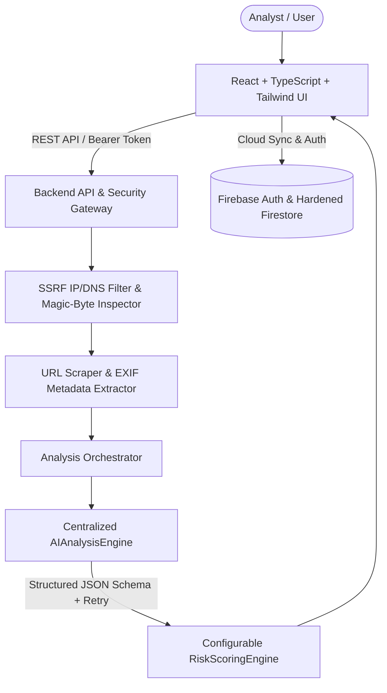

# TruthLens AI — Multimodal Content Authenticity Analyzer

**TruthLens AI** is a production-grade full-stack web application that inspects **public URLs** and **uploaded images** to detect manipulation indicators, synthetic/AI-generated media signals, metadata anomalies, and source provenance risks.

> **Responsible AI Notice**: TruthLens AI presents every assessment as a **probabilistic evaluation** backed by observed technical and editorial signals — never as 100% certainty or absolute forensic truth.

---

## 1. Architecture Overview



---

## 2. Core Features

- **Centralized `AIAnalysisEngine`**: Single provider-agnostic AI engine abstraction (`analyzeUrl`, `analyzeImage`) enforcing strict JSON schema validation, retry logic, and separation between observed evidence, AI inference, and uncertainty.
- **URL Authenticity Analyzer**:
  - Validates URL syntax and blocks SSRF targets (`localhost`, `127.0.0.1`, `0.0.0.0`, private RFC1918 IPv4/IPv6 ranges, cloud metadata endpoints `169.254.169.254`, and DNS rebinding).
  - Extracts domain hierarchy, HTTPS status, OpenGraph, Twitter Card, canonical URL, Schema.org JSON-LD, author attribution, publication dates, and verbatim text snippets.
- **Image Forensics & Metadata Analyzer**:
  - Verifies raw binary magic bytes (`.jpg`, `.jpeg`, `.png`, `.webp`), pixel dimensions, color mode, compression profile, and SHA-256 hash.
  - Extracts EXIF tags (Camera Make/Model, Timestamp, Software, GPS) and redacts exact GPS coordinates by default behind an explicit `[Show metadata]` privacy toggle.
- **Transparent Weighted Risk Scoring**:
  - Configurable component weights (`Source: 20%`, `Content: 20%`, `Metadata: 15%`, `Visual: 30%`, `AI Assessment: 15%`).
  - Maps scores to explainable tiers: `0–30 Low Risk`, `31–60 Moderate Risk`, `61–80 High Risk`, `81–100 Very High Risk`.
- **Forensic PDF Report Export**: Client-side PDF generation (`jsPDF`) containing executive summary, component risk breakdown, signals, technical metadata, recommendations, and Responsible AI disclaimers.
- **Demo Mode**: Instant offline-capable Demo URL and Demo Image specimens clearly labeled as `DEMO RESULT`.

---

## 3. Environment Variables (`.env.example`)

```ini
GEMINI_API_KEY="YOUR_GEMINI_API_KEY"
AI_PROVIDER="gemini"
AI_MODEL="gemini-3.8-flash"
JWT_SECRET="replace-with-strong-secret-in-production"
MAX_IMAGE_SIZE_MB="10"
RATE_LIMIT_ENABLED="true"
RATE_LIMIT_ANON_PER_HOUR="15"
RATE_LIMIT_AUTH_PER_HOUR="60"
WEIGHT_SOURCE="0.20"
WEIGHT_CONTENT="0.20"
WEIGHT_METADATA="0.15"
WEIGHT_IMAGE="0.30"
WEIGHT_AI="0.15"
```

---

## 4. Running Locally, Testing & Docker

```bash
# Install dependencies
npm install

# Run full-stack development server on http://localhost:3000
npm run dev

# Run automated SSRF, Magic-Byte, Risk Scoring, and API tests
npm test

# Type-check and build production bundle
npm run lint
npm run build

# Run with Docker Compose
docker compose up --build
```

---

## 5. Known Limitations & Future Improvements

- **Probabilistic Nature**: Highly sophisticated adversarial edits or uncompressed synthetic outputs may evade visual heuristics; C2PA cryptographic provenance verification is planned for v2.
- **JavaScript-Heavy SPAs**: Websites requiring client-side authentication or CAPTCHA challenges cannot be scraped anonymously.
- **Future Modalities**: `VideoAnalyzer`, `AudioAnalyzer`, `DocumentAnalyzer`, and `DeepfakeAnalyzer` plugin interfaces are registered for future expansion.
